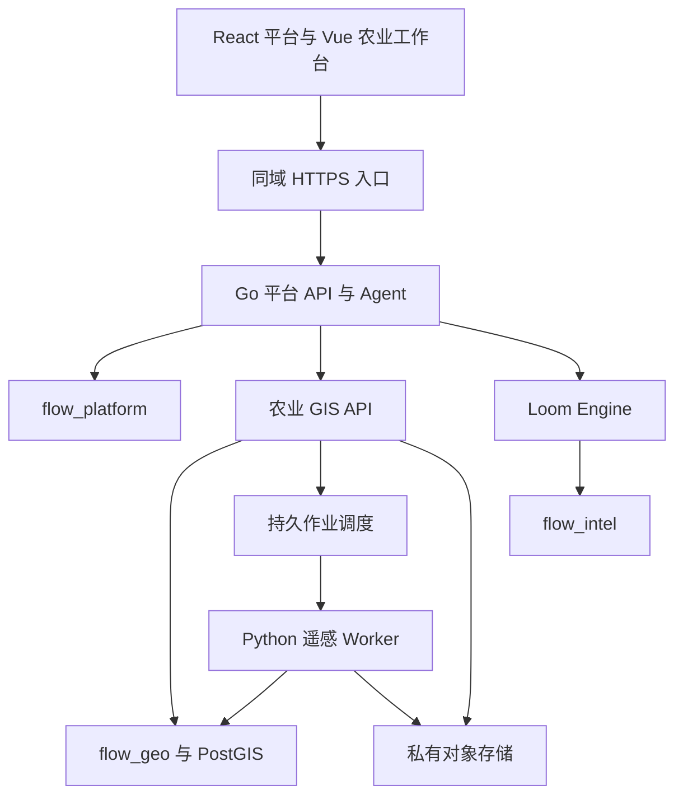
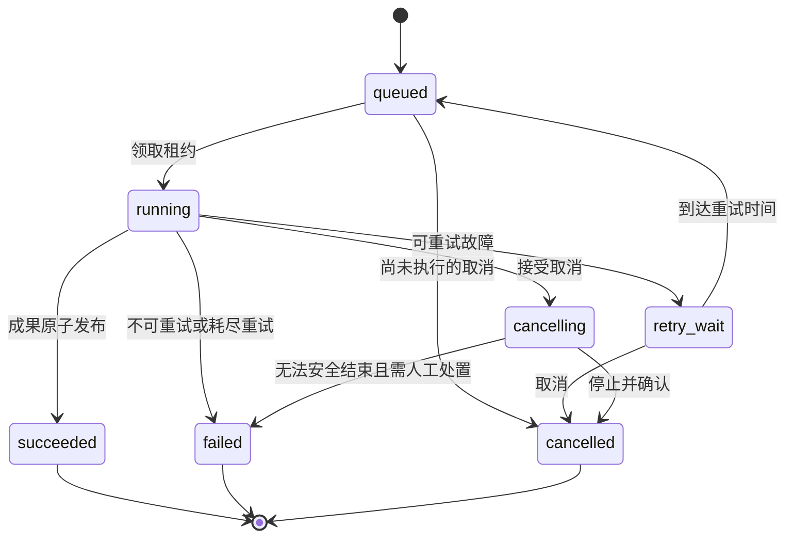

# WeaveSense-DigitalTwin 技术架构

版本：1.0.0  
日期：2026-10-29，Asia/Shanghai  
适用阶段：S0–S5；S0–S3 为首个商用版本，S4–S5 为后续能力。

本文件规定系统边界、数据权威、身份与租户传递、空间处理、持久任务、Agent 集成和部署方式。产品范围以 [PRD](../PRD.md) 为准；字段与接口以 [数据和 API 契约](DATA_API_CONTRACTS.md) 为准；安全测试以 [安全与租户规范](SECURITY_TENANCY.md) 为准。所有新增组件均属于待开发设计，不表示上游已经实现。

## 1. 架构决策与已核实基础

### 1.1 保留平台主干，独立建设农业领域服务

WeaveSense-Flow 已采用 Go 平台负责身份、主 Agent、审批与计费，Loom Engine 负责采集、材料和研究的分工，且要求 API 与 Outbox/Inbox 交互、服务不互写数据表。[现有架构依据](https://github.com/newyngwieslash-ops/WeaveSense-Flow/blob/206c82af7ae007f45da4c582f373fbabf027f1b8/docs/flow/architecture.md)

本项目在此基础上增加农业 GIS 服务与遥感 Worker：

| 组件 | 权威职责 | 明确禁止的职责混用 |
| --- | --- | --- |
| Go 平台 | 用户、租户、成员、工作区、资源授权、Agent 运行、审批、套餐权益、预算、账本、公开 API | 不直接更新 GIS 数据表；不在请求进程运行大型栅格计算 |
| 农业 GIS API | 农场、地块、种植季、观测、数据资产、影像、分析作业、外业与领域质检 | 不另建可独立登录的客户账号体系；不维护可消费余额 |
| Python 遥感 Worker | 受控计算、产物校验、分区统计、栅格和矢量转换 | 不接受任意脚本、任意文件路径和任意外网 URL；不直接扣积分 |
| Loom Engine | 农业公开知识、授权资料、采集、索引、检索与证据报告 | 不作为地块空间数据库；不把检索文本当作传感实测 |
| Vue 农业子应用 | 地图、时间轴、标注、外业、分析结果、领域审核 | 不自行判断最终权限；不继续允许用户编码切换身份 |
| React 平台工作台 | 导航、组织管理、Agent 会话、账户、统一任务与通知入口 | 不维护第二份地块或影像事实 |
| PostgreSQL 与 PostGIS | 领域数据、事务、租户隔离、作业账本及事件 | 不把所有服务迁移混为一个不可追踪脚本 |
| 对象存储 | 原始影像、附件、COG、报告和结果实体 | 不启用私有农业数据公共读取；不以文件名代替资源权限 |
| Redis，可选复用 | 短期缓存、限流、通知与调度唤醒 | 不作为唯一作业状态、账本或审批存储 |

### 1.2 服务拓扑

只有入口代理对公网提供服务。平台、GIS、Loom、数据库、Redis 和对象存储管理端默认留在私网。对象下载使用在线授权代理；可选短期直签路径的撤回语义见第 4 节。

### 1.3 技术栈与依赖策略

保留 Go/Gin 平台、Node/Pi Agent 运行时、TypeScript/Node Loom、Python/FastAPI GIS 和 Rasterio/GDAL。新增后系统不是纯 Go 项目。具体语言版本从固定上游锁文件建立兼容矩阵，不凭文档中的“最新版本”直接升级；升级必须有独立变更、许可检查和回归证据。

OpenLayers 为二维地图核心，Cesium 为可选且按需加载的三维展示。首发生产构建移除 tldraw 使用路径及不必要依赖；确需启用时以有效商业许可为前提，不修改许可验证。PostGIS 作为数据库正常读写使用；主项目与第三方软件、影像、底图、字体和模型权重分别维护许可记录。

## 2. 仓库与版本管理

PROJECT_ROOT 为开发仓库根目录。完整规格应放入 PROJECT_ROOT/specs/agriculture/v1.0.0，称为 SPEC_ROOT。规格包中的 AGENTS.md 用于合并农业规则，不覆盖已有根 AGENTS.md；上游根 PRD、数学及影视文档也保留。

建议新增目录如下，最终名称须由 W00 对实际仓库核实后冻结：

| 路径 | 内容 |
| --- | --- |
| backend/internal/agri | 平台农业适配器、公开 API、授权与任务投影、Agent 工具桥接 |
| backend/internal/flow | 保留现有 Agent 运行链；仅在明确扩展点增加农业主体与能力 |
| web/src/features/agriculture | React 农业入口、平台任务和 Agent 地图联动 |
| services/agri-gis | 固定 AgriScope 快照的受控导入与领域改造 |
| services/agri-gis/frontend | 首轮保留的 Vue GIS 独立构建 |
| services/agri-gis/backend | FastAPI、领域服务、PostGIS DAO、Worker 与迁移 |
| services/loom-engine | 原有知识采集与研究服务；增加农业配置和契约适配 |
| contracts/agriculture | OpenAPI、事件 JSON Schema、农业工具 Schema 与生成 SDK |
| deploy/agriculture | 开发、验收、生产的配置及初始化、备份恢复入口 |
| tests/agriculture | 跨服务契约、安全负例、端到端与样例数据 |
| specs/agriculture/v1.0.0 | 本规格、状态、工作包与开发证据索引 |

WeaveSense 主干固定为 206c82af7ae007f45da4c582f373fbabf027f1b8，AgriScope 固定为 571a2dcd9abf8b8a22b66c750ee710b61d482051。保留来源地址、提交、许可证和导入方式，可使用 git subtree 或等价可审计方式。后续上游升级采用独立分支，先比较接口、迁移、依赖与安全变更，再执行兼容测试。不能直接把上游 main 的变动自动合入生产。

开发时不创建未经确认的远程仓库，不声称 WeaveSense-DigitalTwin 已有远程地址。用户已有仓库时在隔离分支实现；不得强推、重写上游历史或覆盖工作区中未归档的用户修改。

## 3. 数据权威与一致性

### 3.1 三个逻辑数据库

初期可以在同一 PostgreSQL 集群内设置 flow_platform、flow_intel、flow_geo 三个逻辑数据库，各有独立运行角色、迁移角色、备份与迁移编号。PostGIS 在 flow_geo 中启用。高负载时可以将 flow_geo 拆到独立集群，跨服务合同不改变。

Go 权威维护身份、资源访问绑定、商业权益和账本。GIS 权威维护农场及农业事实。农场创建完成后由事件通知平台注册资源；平台登记可访问资源 ID，但不成为农场属性的第二权威。平台只保存必要任务投影、状态与结果摘要，详细数据通过 GIS API 获取。

跨库引用使用不可变 ID 与受控 API 校验，不创建假装跨库有效的外键。每一服务在自身数据库内保证事务；跨服务使用至少一次投递、幂等收件箱和对账。没有跨数据库“恰好一次”执行承诺。

### 3.2 领域身份与时间

地块具有稳定 parcel_id，几何变更生成不可变 parcel_revision。分割和合并建立新地块身份并记录 lineage，原地块转入历史；不能复用父地块 ID 冒充一个子地块。

种植季与地块分开，保存时间区间、作物品种、经营主体和所用边界版本。边界变更不会重写过去的观测或报告。确需按新边界重算时生成新分析任务，旧结果保留。

观测同时记录 observed_at 和 ingested_at。只有日期的来源另存 temporal_precision=date，不伪造秒级时间。有效期、记录时间、处理时间、发布状态分开存储。时区按 UTC 存储，用户显示采用明确 IANA 时区；种植日历中的本地日期保留原时区语义。

### 3.3 版本与失效传播

下列对象必须有 revision 或内容 hash：地块边界、种植季配置、影像、质量规则、分析参数、算法/模型、Agent 技能、工具 Schema、报告与价格表。

每次分析绑定输入快照。地块或规则变化可以使结果成为 historical/stale，但不能原地改写已完成结果。旧结果仍可审计，不能继续充当当前有效决策证据。撤回来源会触发依赖索引，阻断新的下载、共享、检索和报告发布；历史记录保留撤回理由，删除策略按权利和保留政策处理。

系统应区分：

- execution_status：任务是否执行完毕；
- outcome：得到有效结果、数据不足或业务不适用；
- validity：成果当前有效、历史或已撤回；
- publication_status：草稿、审核中、已发布或已撤回。

这四个维度不得合成一个 success 布尔值。

## 4. 身份、租户与资源访问

### 4.1 外部请求

浏览器统一使用平台会话。API 从会话解析 user_id、当前 tenant_id 和 workspace_id；客户端可以选择工作区，但服务端必须确认成员关系。浏览器不能通过 operator_code、requester_code、tenant_id 请求字段指定可信身份。

农场授权为角色能力与资源范围的交集。viewer、analyst、editor、field_operator、reviewer、farm_manager、tenant_admin、billing_admin 是推荐角色；实际能力拆为读取、编辑、计算、审核、管理、计费等细粒度权限。管理员管理租户不自动得到模型供应商密钥或任意数据库访问。

Cookie 会话的农业写请求沿用平台 CSRF token、来源校验和 Cookie 安全属性；同域子应用不是取消 CSRF 防护的理由。手机号、精确 GPS、照片 EXIF 和客户原始资料按字段/用途权限输出，默认不进入运行日志、客服列表或无关 Agent 上下文。详见 [协议约定](DATA_API_CONTRACTS.md)。

### 4.2 平台到 GIS 的委托

平台生成 audience=agri-gis 的短期签名上下文，包含 issuer、subject、actor、tenant_id、workspace_id、resource_scope、scopes、authorization_version、issued_at、expires_at、jti、trace_id 和 request_id。建议有效期 60 秒，最长不超过经过安全批准的上限；长期作业不保留过期用户令牌继续访问。

会产生副作用的服务委托同时绑定 HTTP 方法、路由、规范化载荷 hash 和 operation_id；GIS 拒绝令牌被改作其他资源/动作。jti 的重放处理与业务幂等联合设计：重复同一受权请求可返回原 operation，不能创建新副作用；不同请求复用同 jti 必须拒绝。

GIS 验签、检查 audience/时效/密钥版本后，还要读取资源归属和权限版本。请求字段中的农场 ID 必须属于令牌范围与该租户。密钥通过受控发现或配置轮换，不能接受令牌自带任意密钥地址。浏览器不会获得服务间凭据。

调度器使用独立 service principal，将授权范围限制到 job_id、tenant_id、可用输入和输出前缀。Worker 执行、结果发布和下载时仍检查撤权/撤回条件。发起者被移除或审批过期时，停止需要该权限的新步骤；管理员重新授权须留下新的授权记录。

### 4.3 RLS 与连接池

普通平台/GIS运行角色不是表所有者，不具有 BYPASSRLS、SUPERUSER、创建角色或修改策略权限。所有租户表包含 tenant_id，索引、唯一约束与可约束的外键均包含租户维度。策略使用 USING 和 WITH CHECK；没有有效租户上下文时普通读写默认拒绝。

每次请求和每个作业状态操作在短事务中设置事务局部租户上下文，禁止在连接池连接上持久 SET 后复用。事务退出即清理；异常和取消必须回滚。后台管理员任务单独使用显式受控角色，并记录原因和作用范围。

现有 Flow RLS 将空范围视为系统模式，因此迁移必须先盘点后台 Agent、回调、通知、账本和数学模块的使用路径，补充显式系统上下文后再收紧策略；不能只改一行策略导致既有功能失效。[当前实现](https://github.com/newyngwieslash-ops/WeaveSense-Flow/blob/206c82af7ae007f45da4c582f373fbabf027f1b8/backend/internal/database/flow_rls.go)

PostgreSQL 官方说明了表所有者和 BYPASSRLS 的例外，RLS 不能代替正确的角色授权。[官方依据](https://www.postgresql.org/docs/current/ddl-rowsecurity.html)

### 4.4 下载、瓦片和撤回

默认通过平台在线鉴权代理访问私有成果及瓦片，每次请求验证租户、资源、有效状态与权限版本，返回私有缓存策略。内部瓦片缓存键包含 tenant_id、asset_revision、style_hash、permission_version 和 tile 坐标；不同租户的路径、缓存和 CDN 对象不得混用。

允许直签下载的非强撤回资料须由权益策略显式开放，默认 TTL 不超过 60 秒。已发出的直签 URL 通常在到期前仍可使用，因此退出登录或撤回不能宣称立即失效。需要强撤回的客户影像、受限报告和控制数据只使用在线代理，不使用不可即时撤销的直签。[对象存储访问语义](https://docs.aws.amazon.com/AmazonS3/latest/userguide/using-presigned-url.html)

ETag 只用于对象版本或缓存判断，不视为内容 SHA-256。内容哈希在受控导入/生成时计算，写入不可变 manifest；关键成果在发布与完整性巡检时复核，下载路径检查版本、有效状态与 manifest。

## 5. 影像与矢量数据链

### 5.1 原始数据入库

统一流程为：登记来源和权利 → 建立上传会话 → 临时对象上传 → 大小/格式/哈希验证 → 空间与时间元数据验证 → 质量检查 → 生成可用版本。

分片会话绑定租户、资产、预期大小、内容类型和过期时间。分片完成仅说明字节上传结束，不能直接变成可分析影像。损坏、格式伪装、压缩炸弹、超像素、超图层或不支持编码的文件进入失败状态；临时对象由按会话归属的垃圾回收删除。恶意文件不会被 shell 拼接执行。

STAC 接入只接受已登记 provider、collection、item_id 及选择范围；服务端重新获取 Item 并按允许域解析资产。客户端传入的任意 URL、重定向到私网的地址、云元数据地址和本地文件路径一律拒绝。临时下载签名不进入数据库来源字段、日志、报告或 Agent 上下文。

### 5.2 空间与精度

公开 GeoJSON 采用 RFC 7946 的经度、纬度顺序。源数据另存 source_crs、axis_order、transform_pipeline 和精度说明；未知 CRS 不自动猜测。CGCS2000、WGS84 与底图显示坐标之间的转换必须显式配置，显示适配不得改写权威数据坐标。[GeoJSON 依据](https://www.rfc-editor.org/rfc/rfc7946)

面积使用 geography 椭球面积或经评估的区域等面积投影，统一内部单位平方米，再转换为公顷或亩。经纬度 geometry 的平面面积不可直接解释为平方米。[PostGIS 面积语义](https://postgis.net/docs/ST_Area.html)

几何入库验证类型、闭合、自相交、空洞、坐标范围和区域归属。修复工具必须返回修复差异和面积变化，由用户确认后生成新版本；不能静默 ST_MakeValid 后把变化隐藏。split/merge 校验覆盖与面积守恒，容差来自规则版本，不以代码常量替代业务规则。

### 5.3 栅格标准化与质量

影像元数据至少包括传感器/产品族、获取时间与精度、足迹、CRS、仿射变换、像元大小、波段语义、scale/offset/nodata、云与阴影质量来源、单位、分辨率和处理级别。

每个 provider 有版本化波段映射。Sentinel 与不同代 Landsat 不能共享未经校验的固定波段编号。反射率缩放只应用一次，NDVI 分母接近零、饱和、nodata、云影像元均按算法版本规则处理。分类掩膜重采样采用保持类别的策略；连续反射率和分类质量不能使用相同插值方式。

场景级 cloud_cover 只用于候选筛选，不能证明地块内晴空。分析前计算目标地块内有效像元覆盖率、影像共同足迹和配准质量。Sentinel L2A 的场景分类和 Landsat QA 为质量输入，不把原型只下载 RGB/NIR 的路径视为已经完成这些质量门禁。[Sentinel L2A](https://sentinels.copernicus.eu/-/collection-1-level-2a)；[Landsat QA](https://www.usgs.gov/landsat-missions/landsat-collection-2-quality-assessment-bands)

首发默认优先同传感器、相同产品级别与可比较时相。跨传感器或不同物候比较需要显式方法、校准证据与质量说明，不能仅因为坐标对齐就宣称可比。

### 5.4 空间数据服务

大影像转换为经过验证的 COG，保留原始对象；按窗口分块计算并利用概览提供预览。大地块集采用视窗分页、简化几何或 MVT，详情编辑仍读取精确版本。COG 的分块和 HTTP Range 能力可降低按需读取的数据量，但实际性能依赖对象存储和处理实现，必须压测。[COG 标准](https://www.ogc.org/standards/ogc-cloud-optimized-geotiff/)

栅格实体、统计结果、异常多边形和地图样式分别建模；某个彩色图层不能成为唯一分析事实。统计保存有效面积、像元数、聚合方法、阈值、单位和置信/质量标识。

## 6. 持久任务与跨服务计费

### 6.1 提交流程

1. 平台校验登录、资源范围、套餐、预算和输入摘要。
2. 平台以短事务创建 operation、预算 reservation 和 command_outbox；相同幂等键与相同请求返回原 operation。
3. Outbox 发布器向 GIS 提交；GIS 以 tenant_id + operation_id 去重，在自身事务中写 job、固定输入快照和 receipt。
4. 平台接收 GIS 的已接受回执，建立任务投影。响应丢失时重发同一 operation_id；不得新建预算或新作业。
5. Worker 从 flow_geo 领取任务；完成后提交结果事件。平台事件 Inbox 去重，再更新投影与账本。
6. 对账器定期比较 operation、job 和 reservation。远端结果未知时进入 reconciliation，不能直接退款并再次付费执行。

S1 内部验证可以使用零价测试套餐，但仍完整记录用量与幂等键。S3 发布必须通过真实计量、价格版本、退款和异常对账验收。

operation已有而job_id尚未回执时也必须支持取消。平台取消与Outbox领取锁定相同operation：若可证明从未尝试外发，在同一事务封存命令并释放预留；若已尝试外发或送达结果未知，写cancel intent并保留预留，按operation_id向GIS取消/查询。GIS取消接口即使尚无job也持久写cancelled receipt/tombstone，与接单事务使用相同唯一键竞争；迟到提交不能越过它创建可执行job。已经接单的取消转入正常job取消流程。GIS明确确认未执行、拒绝或终止后才能按消费证据结算/释放，单纯404或平台等待超时不构成安全释放证明。

### 6.2 作业状态机

终态之后“再试一次”建立带 retry_of_job_id 的新 job，并保留原作业记录和重新授权的预算；不得直接把终态改回 running。恢复 attempt 仅用于仍处于非终态且通过对账允许恢复的作业。业务数据不足可使 job 执行成功但 outcome=insufficient_data，只发布质量诊断，不发布伪造的有效异常结论。任务执行状态与成果有效性独立。

### 6.3 租约、心跳与 fencing

领取任务在短事务内锁定可领取行，写 worker_id、attempt_no、lease_expires_at 和单调递增 fencing_token。Worker 定期心跳续租；失去租约立即停止发布资格。心跳、进度、状态和产物提交必须携当前 fencing_token，旧 Worker 的迟到写入返回冲突。

计算放在事务之外。大栅格处理采用受限子进程或容器，限制 CPU、内存、临时盘、时间和允许网络；工作目录按 tenant/job/attempt 分开。调度器按租户并发和权重公平分配，避免单个省域任务饿死其他客户。

超时或节点宕机后，协调器将过期租约标记可重试。对纯计算可以重新执行；具有外部收费或写入副作用的步骤先使用供应商幂等键或查询接口对账，再决定重试。缺少远端查询能力时记录 reconciliation，由受控流程解决。

### 6.4 成果原子发布与取消竞态

Worker 先写 attempt 专属临时对象，完成全部实体校验，生成包含对象版本、大小、SHA-256、输入和算法版本的 manifest。随后在短事务中锁定 job，检查 fencing、取消标记、权限与来源有效性，写不可变 result、全部 artifact 引用及 result_outbox，再将 job 改为 succeeded。提交前失败的对象属于孤儿对象，按 attempt 清理，不对用户可见。

取消和成功通过同一 job 行锁或等价版本条件竞争：

- 取消先获准并写入 cancelling：此后的成果发布不得成功，Worker 清理或隔离输出；
- 成功发布先提交：取消返回 TOO_LATE，展示已经完成的结果；
- queued 取消直接成为 cancelled；
- 重复取消返回当前状态，不重复产生计费事件。

需要保证唯一可见终态，但不宣称底层每次计算都只运行一次。多次计算尝试的成本、失败原因和取舍必须可审计。

### 6.5 用量与账本

账本仅在 Go 平台更新，以整数微积分记录 reserve、settle、release、adjustment 和 reconciliation。客户价格与供应商实际成本分别记录，不把 LLM token 价格用于栅格 CPU、面积、影像或存储。

预估报价绑定 price_version、最大可消费额度、计量维度和取消规则。超出已授权上限暂停并要求新的预算授权，不能静默追加扣费。未执行取消全额释放；已执行取消按提交前可见规则结算确认消费并释放余款；外部消费未知进入对账，不能假定零成本。

有效保留预算不得仅因本地超时自动释放。GIS 未明确拒绝或终止的作业，应先查询、取消或对账，再处理余额。对账调整使用新账目冲正，不修改历史 ledger 行。

## 7. Agent、MCP 与地图协作

平台已有五类接口可作为农业适配点：ScopeResolver、ContextProvider、ToolProvider、ToolExecutor、UsageRecorder。[代码依据](https://github.com/newyngwieslash-ops/WeaveSense-Flow/blob/206c82af7ae007f45da4c582f373fbabf027f1b8/backend/internal/flow/runchain.go)

新增 farm/parcel 农业主体或等价受控资源上下文，服务端解析所选农场、地块版本、种植季、地图范围和时间窗。地图选择本身不授予权限；Agent 工具执行时重新检查主体范围。

工具分三类：

| 类别 | 例子 | 执行要求 |
| --- | --- | --- |
| 读取 | 查地块、影像、观测、任务和知识来源 | 当前资源权限、输出限额、证据标识 |
| 可计费计算 | 分析、批量报告、付费数据获取 | 报价、额度、幂等操作、可恢复作业 |
| 写入与发布 | 改边界、指派巡查、审核发布、外部共享 | 结构化预览、对象版本、人工审批或明确授权策略 |

首发 Agent 不获得任意 SQL、shell、GDAL 命令和公网 URL 请求能力。用户自定义 Agent 可配置说明、知识范围和允许工具，但有效权限不得超出配置者与执行者的当前权限交集。可执行第三方技能包若后续引入，必须另有沙箱和供应链验收，不能把上传 Markdown 等同任意代码执行授权。

稳定农业领域 API 是执行权威。内部服务调用可以选择类型化平台适配器，不必所有内部通信都套MCP；面向客户的外部MCP发布仍属于AG-FR-078的S3必做交付，CLI属于AG-FR-077，同一首发商用版本必须完成。公开MCP和CLI使用相同授权、计量、审计和任务入口。工具返回 operation_id、job_id（尚未创建时可空）、artifact_id、layer_id、evidence_refs、quality、observed_at和outcome，避免传递大影像或无界GeoJSON。

地图事件为受控 UI 指令，如 highlight_parcels、show_layer、set_time_range、open_report。事件携会话和租户范围，由前端重新查询授权资源；不得执行工具输出中的任意 HTML、JavaScript、地图服务 URL 或跨域 postMessage。

## 8. 前端与移动外业

### 8.1 首轮子应用

入口在同一 HTTPS 域下按 /agri 提供 Vue 独立应用，平台保留统一导航、登录和账户。使用深链接与服务端会话恢复，不在 URL 放会话令牌。应用切换通过资源 ID 和受控选项传递状态，不复制账号系统。

如果必须嵌入 iframe，先定义来源白名单、严格消息 Schema、CSP 和会话策略；首轮优先独立路由，减少两个框架运行时耦合。React 迁移属于后续可选优化，不能成为首发闭环的前置阻塞。

### 8.2 地图编辑

每次编辑绑定 base_revision 和编辑范围，保存前进行后端拓扑/面积/授权校验。冲突返回最新版本和差异，保留本地草稿，由用户合并；禁止静默覆盖。服务器审计记录几何前后 hash、理由、操作者和审批。

地图目录按租户/工作区/农场过滤，空间索引只帮助查询性能，不提供权限。图层不可用时显示原因，不用示例影像替代。三维地图中的示意高度明确标记，真实高度或设施模型必须具有来源和单位。

### 8.3 外业与弱网

移动浏览器先实现响应式 /agri/field，GPS、拍照、备注和待同步队列。HTTPS 下申请浏览器授权；未授权时允许手工填写并标记来源，不能伪造 GPS 精度。

本地草稿绑定用户、租户和设备会话，退出或切换账号时清理可访问视图及敏感缓存。照片采用分片/独立附件上传，工单可处于 evidence_pending，不把“记录已保存”描述为“所有照片已同步”。重试使用内容摘要与采集编号幂等，坐标、时间或照片变化产生冲突提示。

后续如做微信小程序或原生 App，应复用领域 API 与权限，不把浏览器版本自动认定为小程序已适配。

## 9. 运维、部署与可观测性

### 9.1 三类运行配置

| 配置 | 用途 | 必需条件 |
| --- | --- | --- |
| dev | 本地开发与自动测试 | 本地隔离数据、零价测试计划、显式 fixture 标签，真实网络适配器可选 |
| acceptance | 集成和真实样例验收 | 与生产相同权限/数据库策略/对象接口；至少一个真实影像来源、真实模型工具调用和完整账单路径 |
| production | 商业服务 | HTTPS、密钥管理、私网服务、外部数据授权、备份恢复证据、真实支付或已批准合同账单路径 |

三个配置不能通过切换一个 ENV 就把 fixture 数据变成 operational 数据。production 启动前校验关键安全配置，缺失身份密钥、数据库受限角色或对象授权配置时拒绝启动相关模块，而不是回退到演示模式。

开发、验收和生产分别使用数据库、对象存储前缀/桶、模型和支付凭据；生产密钥不进入开发镜像和客户端包。

### 9.2 日志和指标

每个 API、operation、job、attempt、Agent run 和事件串联 trace_id。日志记录阶段、错误码、耗时和输入版本，避免记录访问令牌、SAS、影像下载签名、原始个人信息和完整敏感 prompt。

指标至少包括：各租户排队时间、作业完成率/重试率、租约失效、孤儿对象、事件延迟与积压、授权拒绝、瓦片缓存命中、影像有效覆盖、分析数据不足率、预算余额差异、单位计算成本、外部来源错误和报告撤回。

运维告警本身也有去重、恢复与接收回执；开发本系统不自动向用户以外的人发送消息，真实外部通知联调需要已授权目标。

### 9.3 备份与恢复

分别备份三库、对象版本及 manifest、应用配置和密钥恢复材料；数据库与对象的恢复点通过备份清单关联。试点目标 RPO 24 小时、RTO 4 小时属于待实测工程目标，不是既有 SLA。

恢复演练须在隔离环境完成：重建数据库、恢复对象、核查缺失/孤儿引用、重新执行 RLS 负例、任务对账、预算对账和报告 hash 校验。队列重放不得重新收费。密钥轮换与撤销记录保留，恢复不能重新激活已撤回的共享。

## 10. 性能目标与验证方法

以下是首批试点的验收设计，不是上游已证明的性能，也不是采购容量承诺。基准使用 8 vCPU、32 GB 内存和 SSD，记录 CPU 型号、磁盘、数据库/Worker 是否同机、网络与对象存储位置。

| 场景 | 初始目标 | 测量限制 |
| --- | --- | --- |
| 每租户 10 万地块的常见列表/范围查询 | p95 小于 2 秒 | 按固定视窗、权限、分页和返回量测试；不返回全量精细 GeoJSON |
| 5000 要素以内地图窗口 | 可交互目标小于 3 秒 | 指定桌面浏览器、网络、冷/热缓存和几何复杂度 |
| 长任务提交 | p95 小于 1 秒 | 不包含后续计算；远端故障仍需快速返回可追踪 operation |
| 20 并发会话 | 无跨租户结果及明显饥饿 | 与 Worker 并发分别记录，不能推算可付费客户数 |
| 5000 万像元栅格分块处理 | 在配置内存和临时盘内完成或明确拒绝 | 实测运行时间与峰值资源；不得一次全图加载或取消上限冒充支持 |
| 任务恢复与事件重投 | 终态唯一、成果不重发、账单不重复 | 注入网络中断、数据库重启、Worker 杀进程和回调重放 |

超过该档位需单独建立数据与并发基准；全国/省域连续处理、海量设备和秒级实时监控不在首发性能承诺中。

## 11. S4 与 S5 扩展边界

S4 增加设备身份、协议适配、质量标识、遥测去重、迟到数据、离线状态、时间轴和规则告警。设备消息按设备认证，不使用人工操作人编码代替设备凭证。先定义观测合同，再按客户实际协议选择 MQTT 或 HTTP 接入。

S5 增加农学模型注册、训练/校准来源、独立验证、预测区间与情景对比。模型在生产启用前需要明确适用作物、地区、季节和输入完整性；观测值、拟合值、预测值和模拟值分列，不能在同一图表中无标识混合。

设备控制默认关闭。即使已有建议生成，也不等于可以自动执行。控制适配还需现场安全阈值、人工授权、命令幂等、设备确认、超时、撤销和紧急停止。缺设备或农学验证材料可标记 blocked_external，但不影响已完成首发平台能力的真实交付。

